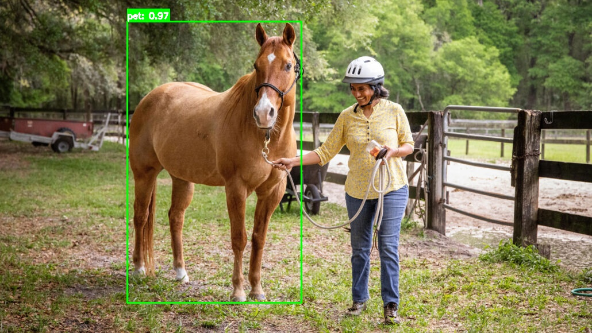

# Florence-2 → YOLOv8 Object Detection

An end-to-end detection pipeline that removes the annotation bottleneck: **Florence-2**
generates bounding boxes zero-shot over unlabelled Flickr30k images, the low-confidence
ones are filtered out, and the surviving labels train a **YOLOv8** detector on two
classes - `person` and `pet` (dog, cat, horse).

The repository covers dataset construction, annotation filtering, augmentation,
training, evaluation and inference.



---

## Results

Two models were trained on the same generated dataset, differing only in augmentation.
Final validation of each, as recorded in [`evaluation_summary.md`](evaluation_summary.md):

| Metric | Baseline | Augmented |
| --- | --- | --- |
| mAP@0.5 | 0.875 | 0.876 |
| mAP@0.5:0.95 | **0.712** | 0.687 |

Best epoch reached during training, from the raw logs in `results.csv`:

| Run | best mAP@0.5 | best mAP@0.5:0.95 | best epoch |
| --- | --- | --- | --- |
| `custom_detection_baseline` | 0.896 | 0.721 | 150 |
| `custom_detection_augmented` | 0.896 | 0.720 | 138 |

**The honest conclusion: the heavier augmentation did not improve accuracy here.**
The two runs land within noise of each other on mAP@0.5, and the augmented model is
slightly *worse* on the stricter mAP@0.5:0.95 in final validation. Its one measurable
edge is reaching its best epoch a little sooner. On a dataset whose labels are
themselves model-generated, label noise - not augmentation - is the limiting factor.

The two runs differ in `degrees` (0 → 10) and `mixup` (0 → 0.2); mosaic (1.0) and
random erasing (0.4) are on in both. See the `args.yaml` in each run directory.

Per-run curves and matrices are in
[`yolo_training/`](yolo_training): confusion matrix (raw and normalised), P / R / F1 /
PR curves, `results.png` and the full `results.csv`.

### Known limitations

- **Person recall is the weak point.** In the sample image above the horse is detected
  at 0.97 but the handler is missed entirely. Florence-2 tends to under-label people in
  cluttered scenes, and the detector inherits that gap.
- **Class imbalance** between `person` and `pet` was never corrected.
- **`pet` merges dog, cat and horse** into one class, so the model is not asked to
  separate them.
- Annotations were never manually audited; quality is bounded by Florence-2's output.

---

## Pipeline

**1 · Dataset creation** - [`dataset_creation.ipynb`](dataset_creation.ipynb)
Runs Florence-2 over Flickr30k images, keeps detections above a confidence threshold,
maps the raw vocabulary onto `person` / `pet`, applies augmentation to under-represented
classes, and writes COCO JSON.

**2 · Conversion** - same notebook
COCO → YOLO `.txt` labels plus a `dataset.yaml` for Ultralytics.

**3 · Training** - [`model_training.ipynb`](model_training.ipynb)
Trains YOLOv8 twice (baseline and augmented), 200-epoch budget with `patience: 30`,
`imgsz: 640`, `batch: 16`, checkpointing and resume. Evaluates mAP@0.5 and mAP@0.5:0.95
and writes confusion matrices and PR curves.

**4 · Inference** - [`inference_code.ipynb`](inference_code.ipynb)
Runs the trained weights on new images with a CLAHE + sharpening + gamma preprocessing
stage. Raw vs preprocessed on the same photo: `pet 0.92` → `pet 0.97`
([`results/test_image_result.jpg`](results/test_image_result.jpg) vs
[`results/test_image_result_1.jpg`](results/test_image_result_1.jpg)).

---

## Layout

```
dataset_creation.ipynb              Florence-2 annotation → filtering → COCO → YOLO
model_training.ipynb                YOLOv8 training and evaluation
inference_code.ipynb                inference with preprocessing

object_detection_dataset/
  dataset.yaml                      Ultralytics config (2 classes)
  annotations/*.json                generated COCO annotations (train / val)

yolo_training/
  custom_detection_baseline/        args, curves, confusion matrices, results.csv
  custom_detection_augmented/       same, with rotation + mixup enabled

results/                            test image, raw and preprocessed detections
documentation/                      TTA, ensembling and degrees-of-freedom notes
evaluation_summary.md               baseline vs augmented comparison
model_choice_explanation.txt        why YOLOv8 over Faster R-CNN / RetinaNet / EfficientDet
training_insights.txt               observations collected during training
```

## Not in this repository

Source imagery, the generated dataset and all model weights are excluded - together
they run to roughly 9 GB, and GitHub caps a single file at 100 MB.

| Excluded | How to get it back |
| --- | --- |
| `flickr30k_images/` | [Flickr30k](https://www.kaggle.com/datasets/hsankesara/flickr-image-dataset) (CC) |
| `object_detection_dataset/train/`, `val/` | re-run `dataset_creation.ipynb` |
| `yolo_training/*/weights/*.pt` | re-run `model_training.ipynb` |
| `yolov8m.pt`, `yolov8l.pt`, `yolo11n.pt` | downloaded automatically by Ultralytics |

The generated COCO annotations **are** committed, so the dataset can be rebuilt from the
original images without re-running Florence-2.

## Setup

```bash
pip install -r requirements.txt
```

`transformers` is pinned to `4.51.1` - Florence-2 loads remote code and is sensitive to
the version. A CUDA GPU is strongly recommended for both annotation and training.

Then open the notebooks in order: `dataset_creation` → `model_training` → `inference_code`.

## License

MIT © 2025 Vlad Pavlyuk. Dataset built from Flickr30k (Creative Commons).
